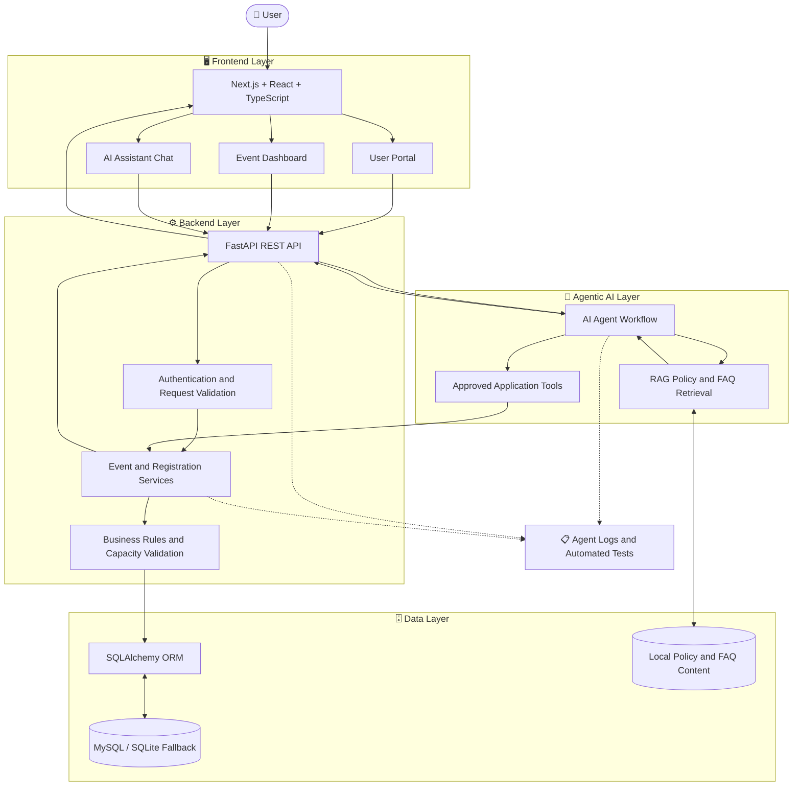

# 🤖 Agentic AI for Smart Event Management Operations

<p align="center">
  <strong>An Intelligent Event Management Platform Powered by Agentic AI</strong>
</p>

<p align="center">
  Simplifying event discovery, registration, administration, and policy assistance through AI-powered automation.
</p>

<p align="center">
  <a href="https://github.com/shaina24-3/agentic-ai-smart-event-management">GitHub Repository</a>
</p>

<p align="center">
  
  
  
  
</p>

---

## 📌 About the Project

**Agentic AI for Smart Event Management Operations** is a full-stack web application developed as part of the **Infosys Springboard Virtual Internship 7.0**.

The application combines modern web technologies with an AI assistant to simplify event-related activities. Users can discover scheduled events, register for events, cancel registrations, check venue availability, and ask questions about event policies through natural-language interaction.

The AI agent connects user requests to approved application tools, while the backend validates operations and manages persistent database records.

The system integrates a web frontend, REST APIs, relational data models, agent workflows, Retrieval-Augmented Generation (RAG), authentication, and automated testing.

## 🎯 Project Objectives

- Develop a centralized platform for event discovery and management.
- Provide secure user registration, login, and profile access.
- Simplify participant registration and cancellation.
- Prevent duplicate active registrations and enforce event capacity limits.
- Validate venue availability and identify scheduling conflicts.
- Integrate an AI assistant for natural-language event requests.
- Use RAG to retrieve relevant event policies and FAQs.
- Maintain reliable backend validation and database updates.
- Test application workflows for correctness and consistency.

## ✨ Key Features

### 👤 1. User Portal
- User registration and login.
- Authenticated profile access.
- Event dashboard and event listing.
- Keyword-based event search.
- Event registration and cancellation.
- Display of backend responses and registration status.

### 📅 2. Event Management
- Browse and view scheduled events.
- Search for relevant events.
- Create and administer events through protected API operations.
- Validate event capacity.
- Check venue availability and scheduling conflicts.

### 🎟️ 3. Registration Management
- Register for available events.
- Cancel active registrations.
- View personal and event registrations.
- Prevent duplicate active registrations.
- Validate registration requests against event capacity.

### 🤖 4. Agentic AI Assistant
- Understand natural-language event-related requests.
- Route requests to supported backend tools.
- Assist with event search and registration operations.
- Support cancellation and venue availability requests.
- Answer event-policy and FAQ questions.
- Return results based on backend tool execution.

### 📚 5. Retrieval-Augmented Generation (RAG)
- Search local policy and FAQ content.
- Retrieve relevant information for event-related questions.
- Support cancellation, capacity, venue, and attendance queries.
- Provide context-based policy assistance.

### 🔐 6. Authentication and Validation
- Secure access to protected operations.
- Validate incoming requests using Pydantic.
- Enforce backend business rules.
- Validate event and registration operations.
- Keep database changes under backend control.

### 🧪 7. Testing and Logging
- Automated backend tests using pytest.
- Authentication and API validation testing.
- Registration and cancellation workflow testing.
- Agent workflow and policy retrieval testing.
- Agent execution and tool-call logging for debugging.

---

## 🏗️ System Architecture

The application follows a modular, layered architecture that separates the frontend, backend API, business logic, AI agent, policy retrieval, and database.

### 🔄 System Architecture Flowchart



### 🧩 Architecture Components

| Component | Responsibility |
|---|---|
| Frontend | Provides the user portal, dashboard, event pages, and AI chat interface. |
| FastAPI Backend | Handles API requests, authentication, validation, and responses. |
| Business Logic | Enforces event capacity, registration rules, and venue scheduling constraints. |
| Agentic AI | Interprets natural-language requests and selects supported application tools. |
| RAG Component | Retrieves relevant policy and FAQ content. |
| SQLAlchemy ORM | Connects application services to relational data models. |
| Database | Persists application records using the configured relational database. |
| Logging and Testing | Supports debugging and verification of application workflows. |

**Key principle:** The AI assistant provides a natural-language interface, but backend services remain responsible for authorization, business-rule validation, and database changes.

### 🔁 Application Workflow

1. The user accesses the frontend and selects an event-related action.
2. The frontend sends an HTTP request to the FastAPI backend.
3. The backend authenticates the user and validates the request.
4. The appropriate event or registration service processes the operation.
5. For assistant requests, the AI agent selects an approved application tool or invokes policy retrieval.
6. Backend business rules are checked before a persistent update is made.
7. The API returns the result to the frontend.
8. The user sees the updated event information, registration status, or assistant response.

---

## 🛠️ Technology Stack

| Technology | Purpose |
|---|---|
| Next.js | Frontend application framework |
| React | User interface development |
| TypeScript | Type-safe frontend development |
| Python | Backend programming |
| FastAPI | REST API development |
| SQLAlchemy | Database ORM and persistence |
| MySQL | Relational database option |
| SQLite | Local development and testing fallback |
| Pydantic | Request and data validation |
| Agentic AI | Natural-language request processing and tool execution |
| RAG | Policy and FAQ retrieval |
| pytest | Automated testing |
| Git and GitHub | Version control and collaboration |

*The exact language-model provider and model configuration depend on the implementation in the repository.*

---

## 📂 Project Structure

The project documentation identifies frontend and backend components. The following is a conceptual overview; individual filenames should be checked against the actual repository.

```text
agentic-ai-smart-event-management/
│
├── frontend/
│   ├── package.json
│   └── Next.js / React application
│
├── backend/
│   ├── FastAPI application
│   ├── API routes
│   ├── Authentication services
│   ├── Event and registration services
│   ├── SQLAlchemy models
│   ├── Agent workflow
│   ├── RAG policy retrieval
│   └── Automated tests
│
├── README.md
└── .gitignore
```

---

## 🔌 API Endpoints

The project documentation specifies the following authentication and assistant endpoints.

| Method | Endpoint | Description |
|---|---|---|
| `POST` | `/api/auth/register` | Register a new user |
| `POST` | `/api/auth/login` | Authenticate a user |
| `GET` | `/api/auth/me` | Retrieve the authenticated user's information |
| `POST` | `/api/chat` | Process an AI assistant message |

The application also supports event and registration operations, including event listing, viewing, creation, updating, deletion, registration, cancellation, and registration retrieval.

Consult the actual FastAPI routes or interactive API documentation for the complete endpoint list, supported methods, request schemas, and authentication requirements.

---

## 💻 Getting Started

### Prerequisites

Install or configure the following as required by the project:

- Node.js and npm.
- Python and pip.
- A supported database configuration.
- AI provider credentials if the configured agent uses an external language model.

### 1. Open the GitHub Repository

Visit the existing project repository:

**[Agentic AI Smart Event Management — GitHub](https://github.com/shaina24-3/agentic-ai-smart-event-management)**

Open the `frontend` or `backend` folder to inspect the relevant source files and configuration.

### 2. Set Up the Backend

Open the backend folder in your development environment.

If the project includes `requirements.txt`, create a virtual environment and install its dependencies.

**Windows:**

```bash
cd backend
python -m venv venv
venv\Scripts\activate
pip install -r requirements.txt
```

Configure the database connection, authentication settings, and AI provider variables according to the backend configuration.

Start the FastAPI server using the actual entry point in the repository. For example, if the application module is `app.main:app`:

```bash
uvicorn app.main:app --reload
```

The module path and command may differ in your implementation.

### 3. Set Up the Frontend

Open a separate terminal and navigate to the frontend folder.

```bash
cd frontend
npm install
npm run dev
```

Configure the backend API URL using the environment variable expected by the frontend.

Open the local address displayed in the terminal, commonly:

`http://localhost:3000`

### 4. Verify the Backend

If FastAPI is configured on port 8000 and its interactive documentation is enabled, open:

`http://127.0.0.1:8000/docs`

Use the API documentation to inspect and test the available endpoints.

**Note:** These commands are examples based on the documented technology stack. Verify the actual dependency files, package scripts, backend entry point, and environment variables before running them.

---

## 🔐 Environment Configuration

Depending on the implementation, the application may require environment variables for:

- Database connection URL.
- Authentication secret or token configuration.
- Frontend backend-API base URL.
- AI provider API key.
- AI model or provider settings.

Use the exact variable names expected by the source code. Store credentials in environment variables and do not commit real secrets to GitHub.

---

## 🧪 Testing

The project documentation describes automated backend tests for authentication, event operations, registration workflows, agent execution, and policy retrieval.

If pytest is configured in the backend, run:

```bash
pytest
```

Important test scenarios include:

- Successful authentication.
- Unauthorized access to protected endpoints.
- Event listing and search.
- Registration for an available event.
- Duplicate active registration prevention.
- Event capacity validation.
- Cancellation without an active registration.
- Venue scheduling conflict checks.
- Agent tool execution and response validation.
- Policy and FAQ retrieval.

Run the test suite against the final submitted code before deployment.

---

## 🚀 Deployment

The frontend and backend may be deployed separately, depending on the repository configuration and hosting platform.

### Frontend Deployment

For a platform such as Render:

1. Connect the existing GitHub repository.
2. Configure the frontend directory as the root directory if required.
3. Set the build and start commands based on `package.json`.
4. Configure the production backend API URL.
5. Deploy the frontend.
6. Verify that the dashboard, event actions, and assistant interface load correctly.

### Backend Deployment

1. Configure the backend directory and Python runtime.
2. Install the required dependencies.
3. Set production environment variables.
4. Configure the production database.
5. Set the correct FastAPI start command.
6. Configure CORS for the deployed frontend origin.
7. Verify authentication, event operations, and AI functionality.

### Deployment Checklist

- [ ] Frontend loads successfully.
- [ ] Backend API is accessible.
- [ ] Database connection works.
- [ ] User registration and login work.
- [ ] Event listing and search work.
- [ ] Registration and cancellation work.
- [ ] AI assistant returns appropriate responses.
- [ ] Environment variables are configured securely.
- [ ] Automated tests pass.
- [ ] No credentials are committed to the repository.

---

## ⚠️ Challenges Addressed

- **Frontend and backend integration:** Connecting interface actions to API operations.
- **Authentication and identity:** Protecting restricted operations.
- **Reliable AI actions:** Ensuring assistant responses reflect actual backend tool results.
- **Capacity validation:** Preventing registrations that exceed event limits.
- **Policy retrieval:** Finding relevant cancellation, venue, capacity, and attendance information.
- **Regression testing:** Maintaining consistent behavior across application changes.
- **AI provider configuration:** Handling external model configuration and runtime errors.

---

## 📈 Learning Outcomes

This project provides practical experience in:

- Full-stack web development.
- Next.js, React, and TypeScript.
- Python and FastAPI.
- REST API design and request validation.
- SQLAlchemy and relational database persistence.
- Authentication and protected API operations.
- Agentic AI workflows and tool calling.
- Retrieval-Augmented Generation.
- Automated testing and debugging.
- Team collaboration and technical documentation.

---

## 🔮 Future Enhancements

Potential improvements for future versions include:

- Personalized event recommendations.
- Email and in-app notifications.
- Calendar integration and reminders.
- Event analytics dashboards.
- Enhanced venue and resource scheduling.
- Multilingual AI assistance.
- Improved event organizer reporting.

These are proposed enhancements and are not claims about existing functionality.

---

## 👩‍💻 Project Team

**Program:** Infosys Springboard Virtual Internship 7.0

**Batch:** 03

**Duration:** 8 weeks

**Team Members:**

- Shaina Garg
- Pallavi Patidar
- Ragolu Yogitha
- Sara Elena Saji
- Kashish Vishwakarma
- Vishnu Vardhan
- Samarth Laddha

---

## 📄 License

If the project is distributed under the MIT License with the team's authorization, include the full MIT License text in a root-level file named `LICENSE`.

Ensure this section matches the license actually included in the repository.

---

## 🙏 Acknowledgements

We sincerely thank **Infosys Springboard** for providing the virtual internship learning platform and project environment. We also acknowledge the guidance of our mentors and the collaboration of our teammates throughout the development and integration of this project.

---

<p align="center">
  <strong>Built with ❤️ using Full-Stack Development and Agentic AI</strong>
</p>

<p align="center">
  <a href="https://github.com/shaina24-3/agentic-ai-smart-event-management">Explore the Project on GitHub</a>
</p>
